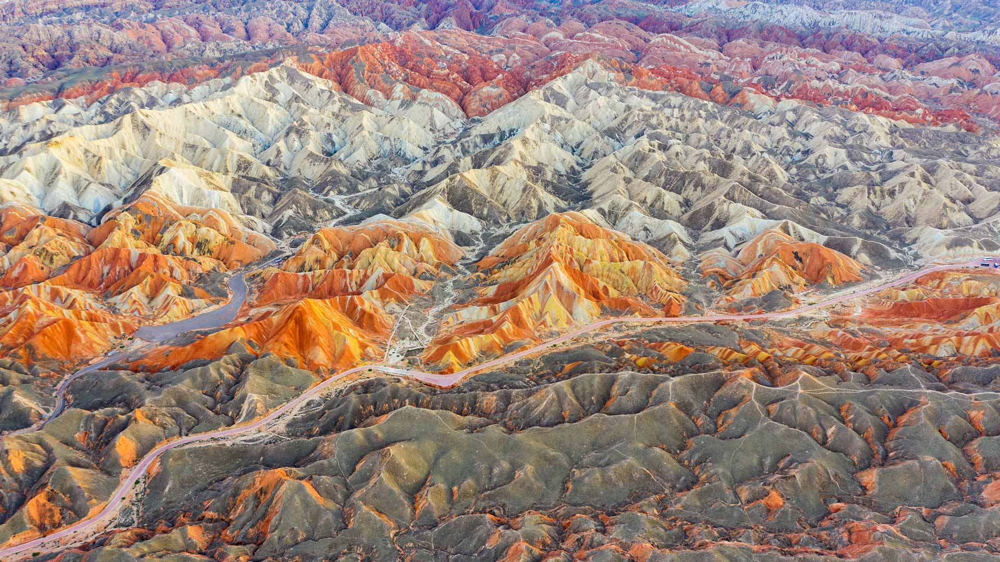

**English | [简体中文](README.zh-CN.md)**

<p align="center">
  
</p>

<p align="center"></p>

An automatically updated archive of Bing's daily wallpapers. Filter by category or color, search the metadata, preview originals and download a selection.

[Open the archive](https://ygn-bing-wallpaper.pages.dev/) · [GitHub Pages fallback](https://yangn-st.github.io/bing_wallpaper_archive/)

## Explore

- Combine keyword, year, month, category and color filters.
- Search titles, copyright text and archive dates.
- Preview an original, switch between 1080p and UHD when available, or copy an image link.
- Download one image directly, or select several and bundle them into a ZIP in the browser.

## Archive

<!-- archive-stats:start -->
- The archive contains **3899 wallpapers** since **2016-03-05**, including 3899 with thumbnails.
<!-- archive-stats:end -->

Images come from Bing's `HPImageArchive` API for `zh-CN`. Categories use keyword rules and a visual model; colors are derived from thumbnails. Both labels are automated and may be imperfect.

## How updates work

- GitHub Actions checks for new images every four hours, around 00:37, 04:37, 08:37, 12:37, 16:37 and 20:37 Beijing time. Actual execution may be delayed.
- A run first checks the latest eight official records and scans the archive for missing thumbnails. If nothing is new and nothing is missing, the download, classification and rebuild steps are skipped.
- New images are downloaded, classified, indexed and validated before the workflow commits. A failed validation stops the commit instead of publishing incomplete data.
- Cloudflare Pages builds the primary site from the commit, and the workflow explicitly dispatches the GitHub Pages backup deployment.

## Categories and colors

- **Categories**: ten groups — people, animals, food, transport, architecture, space, plants, abstract art, landscape and other. Keyword rules handle most images; Qwen2-VL reviews new images and corrects semantic conflicts.
- **Colors**: ten swatches — blue, green, red, yellow, orange, purple, pink, brown, gray-white and multicolor. Pillow extracts the dominant color from each thumbnail, then maps its hue, saturation and brightness to a swatch.

## Archive dates and local builds

Each update checks Bing's latest eight records and uses the official `startdate` as the archive date. It does not use the download date or derive a date from `fullstartdate`; a missing or invalid date stops the update. Existing dates, categories and colors are not changed by later runs.

The local build uses a snapshot of the data and does not follow the remote branch automatically. After refreshing data locally, rebuild the site:

```sh
python3 scripts/download.py
python3 scripts/classify.py
python3 scripts/generate_index.py
python3 scripts/update_readme_stats.py
python3 scripts/check_archive.py
npm run build
```

Install the Python dependencies from `requirements.txt` and the JavaScript dependencies from the lockfile first. `npm run test:archive` checks archive-date handling and the synchronization safeguards.

## Development and deployment

<details>
<summary>Update workflow and deployment notes</summary>

The update workflow is defined in `.github/workflows/update.yml`. It runs the steps in order and saves a report as an Actions artifact for 90 days. `data/first-seen.json` records when this checker first observed each image; that is not Bing's publication time.

Cloudflare Pages hosts the primary site, with a GitHub Pages fallback. See [deployment and rollback](docs/cloudflare-pages.md) for configuration details and the validation steps used before a rollback.

Both READMEs contain an `archive-stats` block that `scripts/update_readme_stats.py` regenerates. Links, the introduction and deployment notes outside that block are maintained by hand and are preserved across updates.

</details>

## License

Wallpaper copyright belongs to its creators and Bing; this project is for archiving and learning. Code is licensed under the MIT license.

[MIT](LICENSE) · [Follow YanGN on Xiaohongshu](https://www.xiaohongshu.com/user/profile/66a7e7ae000000001d023641)
